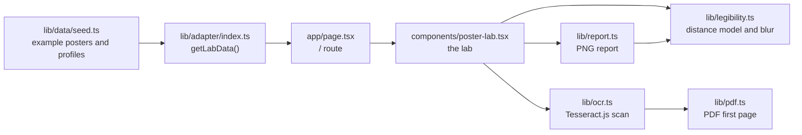

# Telora

Upload your poster and say where it will hang: Telora shows which line of text stops reading from across the hallway, and at exactly how many metres it disappears. Posters get designed 40 cm from a laptop and read from 3 to 5 metres down a corridor, so the date and the room vanish first and nobody finds out until the print is paid for.

**Live:** https://telora.vercel.app (open it and drag the "Viewing distance" slider: that is DEMO step 3).

The live URL runs the real in-browser OCR on posters you upload; the seeded example posters show hand-written sample OCR numbers, labelled "Sample OCR" in the report.

## Try it in 60 seconds

1. Open https://telora.vercel.app. Robot Sumo Night is already loaded on A2 at 4 m.
2. Drag "Viewing distance" from 1 m to 6 m. The poster blurs, the gauge swings to "N of 5 lines readable", and the event date chip reads "Event date: 2.4 m max".
3. Switch "Who is looking" to 20/40, then to Deuteranopia.
4. In "Block by block", click "Open the corrected poster": every line is green at 4 m.
5. Click "Corridor" above the poster to see it hang on a hallway wall.
6. Drop your own PNG, JPG, WebP or PDF in "Check your own poster" and press "Download PNG report".

## How it fits together



## What it does

Pick a poster, a paper size (A3 to A0) and a viewing distance. Telora:

1. Converts every text block's capital height into millimetres on the paper you chose.
2. Works out the visual angle that letter covers at your distance.
3. Compares it with an 8 arcminute threshold for 20/20 vision, raised for weaker eyesight and for low-contrast color pairs.
4. Blurs the live preview to the eye's resolution limit at that distance, and outlines each block in green, amber or red.

Every block gets a line like "Event date: 2.4 m max" and a fix: "enlarge it 1.7x". When size cannot help (red text on green for someone with deuteranopia), it says to change the color pair instead.

Upload your own poster and Telora also re-reads it with OCR at 8 distances, so each line gets a second opinion: "OCR: 2.0 m, model: 2.4 m".

## What works

- The example posters load on `/` with no click, from the seed through one adapter, with a fallback chain (active adapter, then fake adapter, then the seed constants) in `getLabData` (`lib/adapter/index.ts`).
- Live blur preview, verdict outlines, per-line distances and fix recipes, for four vision profiles and four paper sizes.
- A spring gauge for "N of M lines readable" that swings past the new value and settles when the distance, poster, size or profile changes (`components/lines-gauge.tsx`).
- A throwable poster rail (`components/poster-deck.tsx`) with previous and next buttons, and a small pointer tilt on the simulated poster with a mouse (`components/tilt-frame.tsx`). Both stand still under reduced motion.
- The corrected Robot Sumo Night poster (DEMO step 6), opened from the report and back again.
- Upload scan of PNG, JPG, WebP and PDF (first page through pdfjs-dist), with the 8-distance OCR confirmation, in the browser.
- Corridor view (`?view=corridor`): the poster on a hallway wall, sized by the visual angle of the printed sheet.
- PNG report (`renderReportPng` in `lib/report.ts`), drawn on a canvas in the tab.
- Every setting lives in the URL (`?poster=`, `?size=`, `?d=`, `?profile=`, `?view=`). Bad params fall back to defaults.
- Loading, error and empty states for the lab (`components/lab-states.tsx`).

## How the OCR confirmation works

The distance model is geometry. The OCR confirmation is a second, independent signal from an actual reader. It runs only on posters you upload, in your browser (`lib/ocr.ts`, pure logic in `lib/confirm.ts`).

1. **First pass.** Tesseract.js finds the text lines on the sharp poster (long edge scaled to 1600 px).
2. **8 distances.** For each of 1, 1.5, 2, 3, 4, 5, 7 and 10 m, the poster is blurred with the same Gaussian sigma the live preview uses at that distance.
3. **Re-read.** A Tesseract scheduler with 2 workers reads the 8 blurred copies. Each word is assigned to the line whose box contains its center.
4. **The 60% word rule.** A line counts as readable at a distance while at least 60% of its words still match. Its OCR distance is the farthest distance where it and every closer distance pass.
5. **Report.** Each line reads "OCR: 2.0 m, model: 2.4 m", green when OCR reaches at least 85% of the model distance, amber otherwise.

Tesseract gives up on blur earlier than a person who knows what a date looks like, so the OCR number confirms the model; it does not replace it. With `ADAPTER_MODE=fake` (the default) the four example posters carry hand-written sample OCR numbers (`lib/data/ocr-samples.ts`), labelled "Sample OCR". With `ADAPTER_MODE=real` they carry none.

<!-- PROOF:BEGIN ocr -->
Not run in this build: the 8-distance OCR needs a browser and this runner has none.
<!-- PROOF:END ocr -->

## The corrected poster

Robot Sumo Night is lost at 4 m on A2. The fix recipe says "enlarge it 1.7x" for the date, which reaches exactly 4.0 m, still amber because green needs 15% to spare. So the corrected version (`robot-sumo-night-fixed` in `lib/data/seed.ts`) enlarges the date 2.1x and every other lost line until it reads to about 5 m.

<!-- PROOF:BEGIN corrected -->
"Robot Sumo Night, corrected", computed with `lib/legibility.ts` by `npm run proof`.

| Block | Original | Corrected (A2, 20/20) | Verdict at 4.0 m |
| --- | --- | --- | --- |
| Headline | 9.0 m | 9.0 m (9.01 m) | legible |
| Event date | 2.4 m | 5.0 m (4.98 m) | legible |
| Venue | 1.7 m | 5.0 m (5.01 m) | legible |
| Pitch | 1.5 m | 5.0 m (4.98 m) | legible |
| QR caption | 1.1 m | 5.0 m (4.98 m) | legible |
<!-- PROOF:END corrected -->

## What I learned

- The NC State anchor of 20 pt readable to about 7 ft lines up with an 8 arcmin cap height threshold almost exactly. That one number calibrates the whole model.

<!-- PROOF:BEGIN calibration -->
Computed with `lib/legibility.ts` by `npm run proof`.

| Paper | 20 pt cap height | Model distance (20/20) | NC State table |
| --- | --- | --- | --- |
| A3 | 4.9 mm | 2.1 m (2.12 m) | about 7 ft (2.13 m) |
| A2 | 4.9 mm | 2.1 m (2.12 m) | about 7 ft (2.13 m) |
| A1 | 4.9 mm | 2.1 m (2.12 m) | about 7 ft (2.13 m) |
| A0 | 4.9 mm | 2.1 m (2.12 m) | about 7 ft (2.13 m) |
<!-- PROOF:END calibration -->

- A Gaussian blur is a stand-in for the eye's contrast sensitivity function. Lighting, glare and viewing angle are ignored, so the numbers work best as a ranking: if the date lasts 2.4 m and the title 9 m, the date is your problem.
- The calibration rests on one table (NC State); it is a sanity check, not a study with real readers.
- The deuteranopia filter shows in the live lab but is not drawn into the PNG report. The report's distances already include it, and the report footer says so.
- Contrast matters more than expected: peach text on a light ground loses about half its reading distance against dark ink at the same size.

## Stack

Next.js 15 (App Router), React 19, TypeScript 5, Tailwind CSS 4, tesseract.js 6, pdfjs-dist 5, zod 3, @react-spring/web 10, @use-gesture/react 10, lucide-react 0.474, @radix-ui/react-slot 1, class-variance-authority 0.7, clsx 2, tailwind-merge 3, tsx 4 (dev only). Red Hat Display and Red Hat Text through `next/font/google`. Deployed on Vercel with the standard Next build.

## Quickstart

```bash
npm install
npm run dev
npm test
npm run proof
```

Then open http://localhost:3000. No secrets are needed; `.env.example` lists one optional key, `ADAPTER_MODE`. `npm run demo:reset` rewrites the seed snapshot and prints the clean demo URL.

<!-- PROOF:BEGIN tests -->
Tests: 16 passed, 0 failed (2 files, node:test through tsx, written by `npm run proof`).
<!-- PROOF:END tests -->

## Deployed addresses

| What | Address |
| --- | --- |
| Live URL | https://telora.vercel.app |

Plain web app: no contracts, no chain, no wallet. See `SECURITY.md`.

## Built during the event vs before

IdeaLab Hacks ran from 4 to 30 November 2026. This repository was built for the event. The only starting point was a generic Next.js starter (layout, Tailwind setup, empty button, card, badge and input primitives); everything else in the commit history was written during the event: the distance model, the seed posters, the live preview, the vision profiles, the report and fix recipes, the OCR scan and 8-distance confirmation, PDF upload, the corrected poster, the corridor view, the PNG report, the poster rail, the lines gauge, the poster tilt, the adapter and API routes, the tests, the proof script, the illustrations and all copy.

## Prize tracks

| Track | Prize (verbatim) | Slots |
| --- | --- | --- |
| 1st Place | First-place recognition for the highest-scoring eligible project. Non-cash recognition; no monetary prize. | 1 |
| 2nd Place | Second-place recognition for the next highest-scoring eligible project. Non-cash recognition; no monetary prize. | 1 |
| 3rd Place | Third-place recognition for the next highest-scoring eligible project. Non-cash recognition; no monetary prize. | 1 |
| Runner-Up Recognition | Recognition for three additional standout eligible projects. Non-cash recognition; no monetary prize. | 3 |

There is no sponsor bounty row. One Devpost submission enters all four rows automatically.

## AI use

The IdeaLab Hacks policy, in short: AI tools are allowed, not required, their licences must be respected, and their use must be stated. This is that statement.

- **AI coding assistant:** Claude Code (Anthropic) wrote much of the code and copy under my direction, phase by phase. Product decisions, the model choices and the final review are mine.
- **Libraries:** Next.js, React, Tailwind CSS, tesseract.js (with its English language data from jsDelivr), pdfjs-dist, zod, react-spring, use-gesture, lucide-react, Radix Slot, class-variance-authority, clsx, tailwind-merge, and the Red Hat Display and Red Hat Text fonts. Each is used under its own open-source licence.
- **Data:** every example poster and vision profile is hand-authored in `lib/data/seed.ts`, and the sample OCR numbers in `lib/data/ocr-samples.ts`. No external dataset is used.
- **At runtime** there is no language model and no hosted AI service. The only model that runs is Tesseract.js, an open-source OCR engine, in your browser.

## Credits

- Machado, Oliveira and Fernandes (2009), "A Physiologically-based Model for Simulation of Color Vision Deficiency"
- NC State "Legible Viewing Distance for Posters and Exhibits" table, used as the calibration anchor

## License

MIT, see `LICENSE`.
